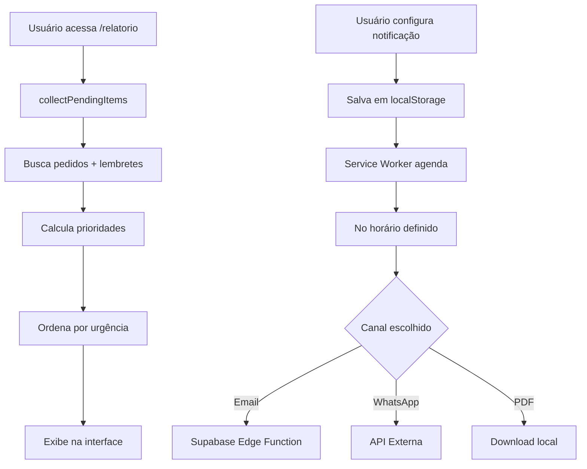

# 🔔 Sistema de Notificações e Relatórios - Documentação

## 📋 Visão Geral

Sistema completo de notificações automáticas e geração de relatórios de pendências para o projeto Encomendas 3D.

**Data de Implementação**: 2026-10-20  
**Versão**: 1.0.0  
**Status**: ✅ Implementado e Testável

---

## 🎯 Funcionalidades Implementadas

### 1. **Serviço de Notificações** (`NotificationService.ts`)

Serviço centralizado que gerencia:
- ✅ Coleta automática de pendências (pedidos + lembretes)
- ✅ Priorização inteligente (urgente/médio/baixo)
- ✅ Geração de relatórios em HTML
- ✅ Múltiplos canais de notificação
- ✅ Agendamento recorrente

**Arquivo**: `src/services/NotificationService.ts`  
**Componentes relacionados**: [[storage]], [[supabase]], [[Order]], [[Reminder]]

### 2. **Página de Relatório** (`ReportPage.tsx`)

Interface visual para visualizar todas as pendências:
- 📊 Cards de resumo com estatísticas
- 📦 Lista de encomendas pendentes priorizadas
- 📝 Lista de lembretes ativos priorizados
- 💾 Botão para baixar HTML
- 🖨️ Função de impressão/exportar PDF

**Rota**: `/relatorio`  
**Arquivo**: `src/pages/ReportPage.tsx`

### 3. **Configuração de Notificações** (`NotificationSettings.tsx`)

Tela para configurar notificações automáticas:
- 📧 Email (requer Supabase Edge Function)
- 💬 WhatsApp (requer API configurada)
- 📄 PDF (download local)
- 🔔 Push (em desenvolvimento)
- ⏰ Agendamento diário ou semanal
- 🕐 Escolha de horário

**Rota**: `/notificacoes`  
**Arquivo**: `src/pages/NotificationSettings.tsx`

---

## 🚀 Como Usar

### Visualizar Relatório

1. Acesse qualquer página (Encomendas ou Lembretes)
2. Clique no botão **📋 Relatório** no header
3. Veja todas as pendências priorizadas
4. Opções:
   - **💾 Baixar HTML**: Salva relatório como arquivo HTML
   - **🖨️ Imprimir/PDF**: Abre diálogo de impressão (use "Salvar como PDF")

### Configurar Notificações Automáticas

1. Na página de Lembretes, clique em **🔔 Notificações**
2. Escolha o canal (Email ou WhatsApp)
3. Selecione a frequência (Diário ou Semanal)
4. Defina o horário desejado
5. Informe o destino (email ou telefone)
6. Clique em **Salvar Configuração**

### Receber Notificações

#### Opção 1: Email (Recomendado)
```bash
# 1. Criar Edge Function no Supabase
cd supabase/functions
supabase functions new send-email

# 2. Implementar código (veja abaixo)
# 3. Deploy
supabase functions deploy send-email
```

#### Opção 2: WhatsApp
```bash
# Requer configuração de API externa
# Opções: Twilio, Evolution API, WhatsApp Business API
```

#### Opção 3: PDF Manual
- Acesse `/relatorio`
- Clique em "Imprimir/PDF"
- Salve como PDF
- Envie manualmente por email/WhatsApp

---

## 🛠️ Implementação das Edge Functions

### Email Function (Supabase)

Crie `supabase/functions/send-email/index.ts`:

```typescript
import { serve } from 'https://deno.land/std@0.168.0/http/server.ts'
import { createClient } from 'https://esm.sh/@supabase/supabase-js@2'

const RESEND_API_KEY = Deno.env.get('RESEND_API_KEY')!

serve(async (req) => {
  try {
    const { to, subject, html } = await req.json()

    // Usando Resend.com (alternativa: SendGrid, Mailgun)
    const response = await fetch('https://api.resend.com/emails', {
      method: 'POST',
      headers: {
        'Content-Type': 'application/json',
        'Authorization': `Bearer ${RESEND_API_KEY}`
      },
      body: JSON.stringify({
        from: 'noreply@seudominio.com',
        to: [to],
        subject,
        html
      })
    })

    const data = await response.json()

    return new Response(JSON.stringify(data), {
      headers: { 'Content-Type': 'application/json' }
    })
  } catch (error) {
    return new Response(JSON.stringify({ error: error.message }), {
      status: 500,
      headers: { 'Content-Type': 'application/json' }
    })
  }
})
```

**Variáveis de ambiente necessárias**:
```bash
supabase secrets set RESEND_API_KEY=re_xxxxxxxxxxxx
```

### WhatsApp Function (Supabase)

Crie `supabase/functions/send-whatsapp/index.ts`:

```typescript
import { serve } from 'https://deno.land/std@0.168.0/http/server.ts'

const EVOLUTION_API_URL = Deno.env.get('EVOLUTION_API_URL')!
const EVOLUTION_API_KEY = Deno.env.get('EVOLUTION_API_KEY')!
const EVOLUTION_INSTANCE = Deno.env.get('EVOLUTION_INSTANCE')!

serve(async (req) => {
  try {
    const { to, message } = await req.json()

    // Usando Evolution API (alternativa: Twilio)
    const response = await fetch(
      `${EVOLUTION_API_URL}/message/sendText/${EVOLUTION_INSTANCE}`,
      {
        method: 'POST',
        headers: {
          'Content-Type': 'application/json',
          'apikey': EVOLUTION_API_KEY
        },
        body: JSON.stringify({
          number: to.replace(/\D/g, ''), // Remove formatação
          text: message
        })
      }
    )

    const data = await response.json()

    return new Response(JSON.stringify(data), {
      headers: { 'Content-Type': 'application/json' }
    })
  } catch (error) {
    return new Response(JSON.stringify({ error: error.message }), {
      status: 500,
      headers: { 'Content-Type': 'application/json' }
    })
  }
})
```

---

## 📊 Lógica de Priorização

O sistema classifica automaticamente cada item como:

### 🔴 Alta Prioridade (Urgente)
- Prazo **vencido** (dias negativos)
- Vence **hoje**
- Vence em **até 2 dias**

### 🟡 Média Prioridade
- Vence entre **3 e 7 dias**

### 🟢 Baixa Prioridade
- Vence em **mais de 7 dias**
- Sem data definida

**Ordenação**: Prioridade → Data mais próxima

---

## 🔄 Fluxo de Funcionamento



---

## 🧪 Como Testar

### 1. Teste Manual do Relatório

```bash
# 1. Criar alguns pedidos e lembretes com datas variadas
# 2. Acessar http://localhost:5173/relatorio
# 3. Verificar:
#    - Estatísticas corretas
#    - Pedidos priorizados corretamente
#    - Lembretes priorizados corretamente
#    - Botões de download e impressão funcionando
```

### 2. Teste de Notificações (Sem API)

```bash
# 1. Acessar /notificacoes
# 2. Configurar email/whatsapp
# 3. Verificar salvamento no localStorage:
localStorage.getItem('notification-schedule')
```

### 3. Teste com Edge Functions (Requer Deploy)

```typescript
// Console do navegador
const report = await collectPendingItems()
await sendEmailReport('seu@email.com', report)
```

---

## 🐛 Troubleshooting

### Relatório não carrega
```bash
# Verificar console do navegador
# Possíveis causas:
# - Erro ao buscar pedidos/lembretes no Supabase
# - Problema de autenticação
# - Tabela reminders não criada
```

### Notificações não funcionam
```bash
# Verificar:
# 1. Edge Functions deployadas?
supabase functions list

# 2. Secrets configurados?
supabase secrets list

# 3. Service Worker registrado?
navigator.serviceWorker.getRegistrations()
```

### Prioridades incorretas
```typescript
// Verificar cálculo de dias
const now = new Date()
const dueDate = new Date('2026-10-22')
const daysUntil = Math.ceil((dueDate.getTime() - now.getTime()) / (1000 * 60 * 60 * 24))
console.log('Dias até vencer:', daysUntil)
```

---

## 📈 Próximas Melhorias

### Curto Prazo
- [ ] Implementar notificações Push nativas
- [ ] Adicionar filtros no relatório (por categoria, status)
- [ ] Gráficos visuais no relatório
- [ ] Export para Excel/CSV

### Médio Prazo
- [ ] Integração com Telegram
- [ ] Relatórios customizáveis (templates)
- [ ] Histórico de notificações enviadas
- [ ] Dashboard de analytics

### Longo Prazo
- [ ] IA para sugerir prioridades
- [ ] Notificações contextuais (localização, clima)
- [ ] Integração com calendário (Google/Outlook)
- [ ] App mobile com notificações nativas

---

## 📚 Referências e Links

### APIs Recomendadas

**Email:**
- [Resend](https://resend.com) - Recomendado, simples e barato
- [SendGrid](https://sendgrid.com) - Robusto, gratuito até 100/dia
- [Mailgun](https://mailgun.com) - Escalável

**WhatsApp:**
- [Evolution API](https://evolution-api.com) - Open source, auto-hospedado
- [Twilio WhatsApp](https://www.twilio.com/whatsapp) - Oficial, requer aprovação
- [WhatsApp Business API](https://business.whatsapp.com) - Diretamente do Meta

### Documentação

- [[NotificationService]] - Código do serviço
- [[ReportPage]] - Interface do relatório
- [[NotificationSettings]] - Configurações
- [[storage]] - Funções de busca de dados
- [[supabase]] - Cliente do banco de dados

---

## 🔗 Componentes Relacionados

Use Graphify para explorar:

```bash
# Ver dependências do NotificationService
graphify path "NotificationService" "storage"

# Entender fluxo de dados
graphify query "como funciona o sistema de relatórios"

# Ver impacto de mudanças
graphify affected "ReportPage"
```

---

**Criado em**: 2026-10-20  
**Última atualização**: 2026-10-20  
**Autor**: Sistema Encomendas 3D  
**Status**: ✅ Pronto para uso
